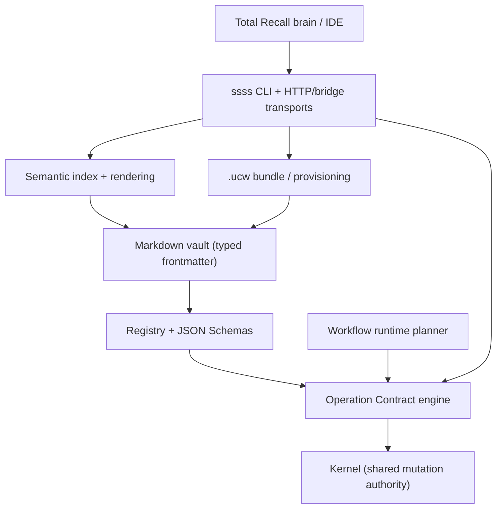

# OpenWiki — SSSS

This repository (`@gregiteen/ssss-cli`) is the **reference implementation of the
Structured Semantic Syntax System** — a database-free, Markdown-first schema and
mutation contract for portable AI-agent state. Its OpenWiki documents the two
distinct layers that coexist in the repo.

## The two layers

| Layer | What it is | Owned by |
|-------|------------|----------|
| **SSSS reference implementation** | The normative spec, registry, JSON Schemas, the shared mutation kernel, the Operation Contract engine, the workflow runtime, the multilingual semantic index, and the `.ucw` bundle/provisioning tooling. | This codebase. |
| **Total Recall brain / IDE** | The operational surface that runs the repo as a Total Recall brain: IDE instruction injection (`AGENTS.md`, `CLAUDE.md`, `.cursor/rules`, `GEMINI.md`), durable memory, skills, and credentials. | The Total Recall CLI + plugins. |

The SSSS layer is the subject of this OpenWiki. The brain/IDE layer is documented
under [IDE connectors](ide.md), [Working memory](memory.md), [Skills](skills.md), and [Secrets](secrets.md).

> **Secrets rule.** Never put API keys, tokens, or credential values in OpenWiki
> pages or compiled IDE instruction files. Credentials go through the Total
> Recall auth plugin (`total-recall auth secret …`) following `TR_SECRETS_BRAIN`.
> See [Secrets](secrets.md).

## What SSSS defines

SSSS is a vendor-neutral standard plus a dependency-free reference engine. It
defines, at a high level:

- **Document primitives** — typed Markdown files with YAML frontmatter, validated
  against a registry rather than hand-written code.
- **The Operation Contract (spec §6)** — four envelope types
  (`operation` / `patch` / `event` / `delete`) for mutating a vault, with
  idempotency replay and audit.
- **The workflow runtime (spec §11.8)** — workflows and standalone triggers
  derive deterministic event/task/run envelopes from the vault.
- **Multilingual semantic runtime (spec §11.9)** — deterministic lexical
  evidence, injected embeddings, and runtime rendering with symbolic controls
  fixed.
- **Portability classification (spec §5.5)** — every primitive is
  `structural`, `tenant_private`, or `resource_bound`, so a vault can be sold or
  shared without leaking private data.
- **The `.ucw` bundle (spec §16) and provisioning contract (spec §17)** —
  package a vault, then `export → provision → import → upgrade` it into a fresh
  environment, deterministically and idempotently.

The package is **dependency-free**: a host needs neither Zod nor a YAML library to
be conformant. The reference engine *is* the validator.

## How the layers fit together



The registry resolves types and portability; the engine is a thin façade over
the kernel, which owns all mutation semantics. See
[SSSS system architecture](architecture.md).

## Where to start

- **New to the codebase?** Start at the
  [Quickstart](quickstart.md) for a task-to-page routing map and the one-command
  entrypoints.
- **Need the mental model?** Read
  [SSSS system architecture](architecture.md), then the concept pages below.

## Pages by area

### Concepts

- [Registry, portability & schemas](concepts/registry-and-portability.md) —
  core registry primitives, extension composition, the three portability classes,
  the zero-dependency frontmatter parser, and Draft 2020-12 JSON Schemas.
- [Operation Contract & mutation kernel](concepts/operation-contract.md) — the
  four envelope types, the `kernel.execute` stages, idempotency replay,
  authorization, and the symbolic `ERROR_CODES` to HTTP status mapping.
- [Bundle format & provisioning contract](concepts/bundle-and-provisioning.md)
  — the `.ucw` manifest/files/provenance shape, parameters and link integrity,
  the `export → provision → import → upgrade` verbs, determinism, and
  idempotency.

### Architecture & Integrations

- [Architecture Overview](architecture.md) — high-level system architecture, layers, and pipeline.
- [Execution Engine](architecture/engine.md) — reference engine implementation, lifecycle stages, and execution flow.
- [Host adapter contracts](integrations/host-adapters.md) — the host-injectable VFS, event store, lease, idempotency, intent, and projection adapters.

### Total Recall & Operational Layer

- [IDE connectors](ide.md) — editor integration and tooling hooks.
- [Working memory](memory.md) — SSSS memory vault primitives and lifecycle.
- [Skills](skills.md) — portable skills and agent capabilities.
- [Secrets](secrets.md) — secrets and credential isolation.

## Repository entry points

```bash
ssss new <dir> --install            # scaffold a starter vault + conformance test
ssss conformance --engine           # replay fixtures + round-trip the reference bundle
npm test                            # conformance --engine + event/frontmatter/durability suites
ssss serve                          # reference HTTP server for operations
ssss bridge                         # stdin/stdout JSON transport for non-JS hosts
```

See the [commands table](quickstart.md) for the full `ssss` command surface and
the authoritative repository layout in the project root `README.md`.
