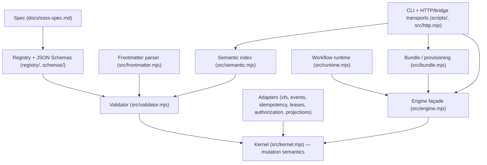
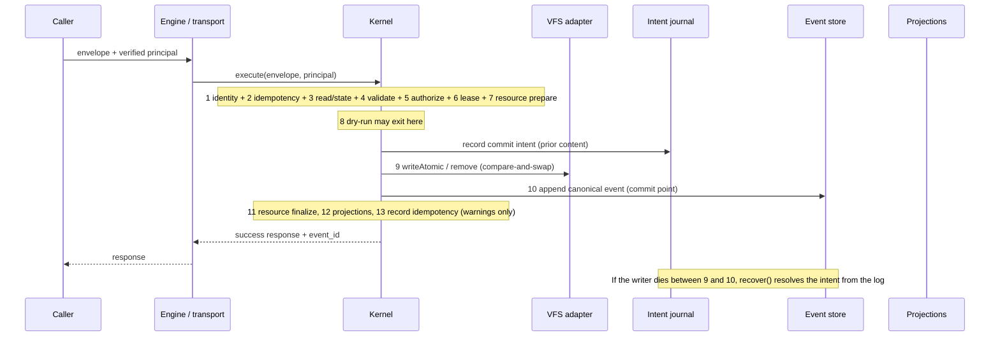
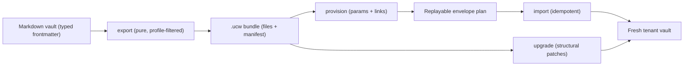

# SSSS system architecture

`@gregiteen/ssss-cli` is the **reference implementation of the Structured Semantic
Syntax System**: a database-free, Markdown-first schema and mutation contract for
portable AI-agent state. This page describes how its layers fit together, how a
mutation flows from a Markdown vault through the Operation Contract into an
immutable event log, and how a vault is packaged into a `.ucw` bundle and
provisioned into a fresh tenant. For the per-layer concepts, see
[Bundle and provisioning](concepts/bundle-and-provisioning.md),
[Operation Contract](concepts/operation-contract.md),
[Registry and portability](concepts/registry-and-portability.md), and
[Host adapters](integrations/host-adapters.md).

## The two layers in the repository

The repository holds two distinct layers; only the first is the subject of this
page.

| Layer | What it is | Owned by |
|-------|------------|----------|
| **SSSS reference implementation** | The normative spec, registry, JSON Schemas, the shared mutation kernel, the Operation Contract engine, the workflow runtime, the multilingual semantic index, and the `.ucw` bundle/provisioning tooling. | This codebase. |
| **Total Recall brain / IDE** | The operational surface that runs the repo as a Total Recall brain: IDE instruction injection, durable memory, skills, and credentials. | The Total Recall CLI + plugins. |

The SSSS layer is dependency-free (`package.json` declares `"dependencies": {}`);
a host needs neither Zod nor a YAML library to be conformant, because the
reference engine *is* the validator.

## Layered architecture

SSSS is built as a stack where each layer either owns a normative truth or
delegates mechanics to an injectable adapter. Nothing above the kernel performs
mutation; nothing below it defines semantics.

*Figure: the SSSS layered architecture. The kernel is the only mutation authority;
the engine is a thin façade, and the runtime, bundle, and transports all reach the
vault through it.*

### Spec → registry → schemas

The normative ground truth is `docs/ssss-spec.md` (spec v0.9). It defines the
document primitives, the Operation Contract (§6), the workflow runtime (§11.8),
the semantic runtime (§11.9), portability classification (§5.5), and the bundle
(§16) and provisioning (§17) contracts. The canonical `registry/core.json` plus
`registry/extensions/*.json` realize §5: every primitive type — its
`required_fields`, `append_only` flag, `immutable_fields`, `references`, and
`portability` class — is declared there, not in hand-written code. Draft 2020-12
JSON Schemas in `schemas/` (`core-registry.schema.json`, `bundle.schema.json`)
give an external validator shape, checked by `src/schema-validator.mjs`.

### Frontmatter and validator

`src/frontmatter.mjs` parses the YAML frontmatter of a Markdown document into
`{ data, body }`. `src/validator.mjs` is a registry-driven validator: it resolves
the declared `type` against the registry, enforces required/optional/immutable
fields, pattern and enum constraints, and `references` integrity (§9). Because a
type's rules come from the registry, the validator has no per-type code — the
same path validates a `workflow`, an `assistant`, or a host's custom extension.

### The kernel owns all mutation semantics

`src/kernel.mjs` is the **shared mutation authority** for 0.9. `createKernel()`
takes injectable adapters — a VFS, an event store, an idempotency store, a lease
store, an authorizer, a projection coordinator, and a resource coordinator — and
exposes `execute(envelope, context)` and `recover()`. The kernel owns the
ordering and semantics of the §6.3 processing pipeline; adapters implement
mechanics only. It defines the symbolic `ERROR_CODES` (`invalid_request`,
`unauthorized`, `forbidden`, `not_found`, `lease_conflict`, `version_conflict`,
`idempotency_conflict`, `validation_failed`, `internal_error`) that every failed
response carries and that transports map to status without parsing messages.

> **Engine is a thin façade.** `src/engine.mjs` is explicitly a *compatibility
> façade* for the pre-0.9 `createEngine().processOperation()` API. It contains
> no second mutation implementation: `createEngine()` builds a `createKernel()`
> per `(vaultRoot, eventLogDir)` pair and forwards every envelope to
> `kernel.execute()`. Its only added behavior is legacy principal translation
> (reading `roles/<role>/ROLE.md` permissions into 0.9 capabilities) and a
> response shaping step that strips the `ssss:` qualifier from the validation
> type for backward compatibility. New hosts should import
> `@gregiteen/ssss-cli/kernel` directly.

### Adapters

Storage and policy are host-injectable contracts (spec §6.7), each with a
reference implementation in `src/`:

- **VFS** (`src/vfs.mjs`) — `MemoryVfs` and `FileSystemVfs` provide
  compare-and-swap `writeAtomic`/`remove` with path safety, reserved lock/intent
  directories (`.ssss-locks`, `.ssss-intents`), and durable `fsync` writes.
- **Event store** (`src/events.mjs`) — `MemoryEventStore` and `JsonlEventStore`
  for the append-only, idempotency-key-indexed event log.
- **Idempotency store** (`src/idempotency.mjs`) — a cache of full responses in
  front of the event log; `FileIdempotencyStore` retains entries 24h by default.
- **Lease store** (`src/leases.mjs`) — optimistic concurrency leases (§7).
- **Authorization** (`src/authorization.mjs`) — verified-principal validation
  and fail-closed capability matching (`<scope>:<action>`, with `*` and path
  scoping).
- **Projections** (`src/projections.mjs`) — replayable, cursor-aware projection
  coordinator and SQL/search destination adapters; projections are disposable,
  rebuildable from the log.
- **Resource coordinator** — an optional host hook for external resources
  (domains, phone numbers) with `prepare`/`finalize`/`reconcile`.

### Runtime, semantic, and bundle layers

Above the kernel, three pure-ish layers turn vault state into derived artifacts
without themselves mutating symbolic state:

- **Workflow runtime** (`src/runtime.mjs`, §11.8) — a deterministic *planning*
  layer, not a resident daemon. It turns workflow and standalone triggers into
  Operation Contract envelopes (events, tasks, runs). The vault remains the
  source of truth; scheduler queues and dashboards are projections.
- **Semantic index** (`src/semantic.mjs`, §11.9) — builds a deterministic,
  privacy-safe lexical index over the vault, extracts link/mention edges,
  normalizes language tags, and supports multilingual embedding and runtime
  rendering. Translations are never stored; canonical documents remain authored
  once.
- **Bundle / provisioning** (`src/bundle.mjs`, §16–§17) — the three provisioning
  verbs: `exportBundle` (vault + profile → bundle, pure), `provisionBundle`
  (bundle + params → replayable plan), and `importBundle` (plan + engine →
  committed state, idempotent). Portability filtering reads the registry's §5.5
  classes, so a `sale`/`template` profile drops `tenant_private` data.

### CLI and transports

The `ssss` CLI (`scripts/ssss.mjs`) is the user-facing surface; `src/http.mjs`
provides reference HTTP and bridge transports. Transports are façades over
`kernel.execute`: `createCommandHandler` authenticates a request, parses the
envelope, and forwards it, mapping the symbolic error codes to HTTP status
(`createCommandHandler`, `statusForResponse`). A transport is never a writer.

## Data flow: vault → Operation Contract → event log

A mutation enters as one of four envelope types — `operation`, `patch`, `event`,
or `delete` — and flows through the §6.3 pipeline inside `kernel.execute`. The
canonical event append (stage 10) is the **commit point**: before it, any failure
leaves no trace; after it, nothing may undo the mutation.

*Figure: the Operation Contract commit pipeline. Stages 1–8 abort cleanly on
failure; stage 10 is the commit point; stages 11–13 are compensated forward as
warnings, never rolled back.*

Key invariants of the flow:

- **Authenticate before storage.** Stage 1 verifies a principal with an `id` and
  `kind` before anything is read, so an anonymous caller learns nothing about the
  vault. The principal's `id` is part of the idempotency request hash, so a key
  replayed by a different principal is a conflict, never a disclosure.
- **Idempotency.** Stage 2 looks up `(workspace_id, idempotency_key)`. A matching
  request hash replays the stored response; a different hash fails with
  `idempotency_conflict`. The event log is the durable record — every committed
  event carries its key and request hash — so the idempotency store is only a
  cache and a cache miss after retention is still resolved from the log.
- **Type immutability and append-only.** Stage 4 enforces that an `operation`
  may not change an existing document's type and that an append-only primitive
  (`conversation`, `run`, `thread`) cannot be replaced or deleted — only
  appended to via a `patch` carrying `__body__`.
- **Commit intents and crash recovery.** For every non-`event` envelope the
  kernel durably records a commit intent (prior content, intended digest, and
  the `event_id` the commit will append) before the stage-9 VFS write, and holds
  the path's commit lock until stage 10 ends. If the writer dies between stages 9
  and 10, `recover()` (run once per kernel before its first operation, and before
  the next commit on that path) resolves the intent: `committed` if the log holds
  the event, `rolled_back` if the vault still has the prior digest, `discarded`
  if stage 9 never landed, or `conflict` if the document changed outside the
  kernel. A live writer's intent is never touched.
- **Concurrency.** Two envelopes racing on one path are serialized by the
  stage-9 compare-and-swap; the loser either finds a same-key winner and returns
  it as a replay, or fails with `version_conflict`. Two `event` envelopes with the
  same key are serialized by the event store's uniqueness on `event_id`
  (`idempotentEventId` derives a UUIDv5 from the workspace and key).
- **Post-commit compensation.** Stages 11 (resource finalize), 12 (projections),
  and 13 (idempotency record) fail *forward*: their failures become warnings on
  the response, never rollbacks, because the append-only log already says the
  mutation happened.

See [Operation Contract](concepts/operation-contract.md) for the operational view of this pipeline.

## The vault → bundle → tenant lifecycle

The `.ucw` bundle (§16) and provisioning contract (§17) turn a vault into a
portable, tradeable package and stand a fresh tenant up from it deterministically.

*Figure: the vault→bundle→tenant lifecycle. `export` drops tenant-private data
per the portability profile; `provision` resolves parameters and link integrity
into a replayable plan; `import` replays the plan through the kernel and commits
nothing on a second run.*

1. **Export** (`exportBundle`, §16) — package a vault into a `.ucw` bundle. This
   is pure and deterministic: a content hash is taken over a path-sorted
   canonical file serialization, and portability filtering reads the registry's
   §5.5 classes. A `backup` profile keeps everything; a `sale` or `template`
   profile keeps only `structural` and `resource_bound` files, dropping
   `tenant_private` data, and reduces `resource_bound` fields to `REQUIREMENT`
   placeholders so a vault can be sold or shared without leaking private data.
2. **Validate / inspect** — `ssss validate` checks a bundle against the schema
   and portability rules; `ssss inspect` prints the manifest, inventory,
   parameters, and steps.
3. **Provision** (`provisionBundle`, §17) — plan an install: resolve parameters
   and link/integrity constraints into a replayable envelope plan. This is where
   template variables, provisioning steps, and resource-binding requirements are
   resolved against the bundle manifest.
4. **Import** (`importBundle`, §17) — replay a bundle/plan into a vault through
   the kernel. It is idempotent: the import derives its idempotency key from the
   workspace, the target path, and the file's content digest, so re-running
   import commits nothing — identical content is an `unchanged` no-op, and a
   different request under the same key is a conflict.
5. **Upgrade** (§17.4) — upgrade an installed vault to a new bundle version via
   structural patches. `tenant_private` documents are immutable during upgrades;
   the kernel rejects an `intent: 'upgrade'` envelope that would modify one.

See [Bundle and provisioning](concepts/bundle-and-provisioning.md) for the concept and workflow detail.

## Extension and conformance

A host extends SSSS by composing an extension registry (`ssss registry compose`)
and injecting adapters that satisfy the §6.7 contracts; it never forks the
kernel. Conformance is fixed by the fixtures in `conformance/` (`ssss
conformance`), which every host must pass, and the `ssss adapter conformance`
suite for the VFS, lease, and idempotency contracts. See [Registry and portability](concepts/registry-and-portability.md) and [Host adapters](integrations/host-adapters.md).
