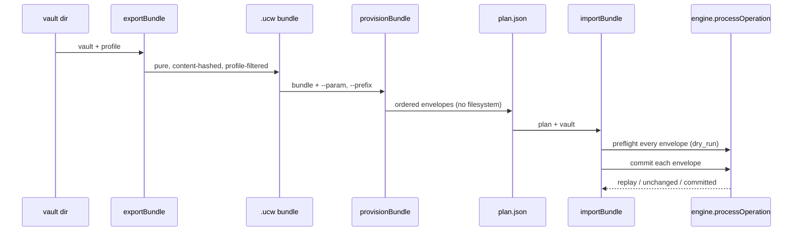

# Bundle format & provisioning contract

The `.ucw` bundle is the transportable package of a vault — "a festival in a
box." It pairs a manifest that declares *what the vault is and what it needs to
run* with the vault's path-sorted files, content-hashed for integrity. The
provisioning contract is the set of three deterministic, idempotent verbs that
move a bundle between vaults: **export**, **provision**, and **import**, plus
**upgrade** for version steps. Both are spec §16 (bundle format) and §17
(provisioning contract); the runtime authority lives in `src/bundle.mjs`, and
the contract vocabulary is declared in `registry/core.json`.

## The bundle shape

A bundle is plain JSON with two required top-level members — `manifest` and
`files`:

```jsonc
{
  "manifest": {
    "name": "Festival in a Box",
    "description": "...",
    "version": "1.0.0",
    "exported_at": "1970-01-01T00:00:00.000Z",   // frozen → deterministic export
    "ssss_core_version": "0.9",
    "required_extensions": [],
    "export_profile": "sale",                      // backup | template | sale
    "primitive_inventory": { "workflow": 1, "page": 1, "rule": 1, ... },
    "provisioning": [ /* binding steps, see below */ ],
    "parameters":  [ /* template variables, see below */ ],
    "file_count": 14,
    "provenance": {
      "content_hash": "sha256:…",                   // over the canonical file serialization
      "exporter": "@gregiteen/ssss-cli@0.14.2"
    }
  },
  "files": [ { "path": "assistants/concierge.md", "content": "---\n…" }, ... ]
}
```

The manifest-required fields are fixed by the `bundle` contract in
`registry/core.json`: `name`, `description`, `version`, `exported_at`,
`ssss_core_version`, `required_extensions`, `export_profile`,
`primitive_inventory`, `provisioning`, `file_count`, and `provenance`. Optional
manifest fields are `parameters`, `source_workspace_id` (operator-identifying —
carried **only** in a `backup` profile), and `branding`. Each `files[]` entry
is exactly `{ path, content }`, and `primitive_inventory` counts every file by
its registry `type` — it is registry-driven, not a closed category enum.

### Integrity and canonical serialization

`provenance.content_hash` is `sha256` over the **canonical** (path-sorted)
serialization of `files`: files are sorted by byte order of `path`, then
serialized as `{ path, content }` objects. Equal vault state therefore yields a
byte-identical bundle, so exports are diffable and cacheable.
`validateBundle` recomputes the hash and rejects any mismatch — a bundle
cannot be silently edited. Validation also checks that `file_count` matches
the actual array length, that `dependencies.integrity.content_hash` (if
present) matches `provenance.content_hash`, and that every file path is a safe
relative path (no leading `/`, no `\`, no `..`/`.` traversal, no null bytes).

Bundle validation applies the registry's field-level schema and
document-reference rules to every file, and it fails closed on compatibility:
a bundle whose `ssss_core_version` the host does not support, or that names a
`required_extensions` entry the host has not loaded, is rejected before any
file is committed. The registry load is scoped to the bundle's own
`required_extensions`; when a named extension is absent the validator reports
it as an error rather than crashing, so the caller sees every problem at once.

## Export profiles and portability filtering

`exportBundle(vault, opts)` walks every `*.md` under the vault (skipping
dotfiles and the `.events` log, and refusing to follow symlinks), reads each
file's `type` from frontmatter, resolves its **portability class** (§5.5) from
the registry, and keeps only the classes the profile permits. The
`PROFILE_INCLUDES` map is the filter:

| Profile | Includes | `resource_bound` | `tenant_private` |
|---------|----------|------------------|------------------|
| `backup` | `structural`, `tenant_private`, `resource_bound` | kept whole | kept (encrypted at rest) |
| `template` | `structural`, `resource_bound` | requirement declaration only | excluded |
| `sale` | `structural`, `resource_bound` | requirement declaration only | excluded |

`tenant_private` primitives (conversations, runs, tasks, customer data) never
ship in a `template` or `sale` bundle — an exporter MUST drop them, and a host
MUST reject a `template`/`sale` export that would emit one.

### Requirement declarations for `resource_bound` primitives

In a `template` or `sale` profile a `resource_bound` file (a domain, phone
number, mailbox, API connection, etc.) is never shipped with the seller's bound
value. Instead `reduceResourceBoundFile` reads the registry type's
`resource.binds` field list and rewrites each bound field to the literal
`REQUIREMENT`, tagging the file with `x_portability: resource_bound`. The
seller's resource value is stripped; only the *requirement* ships.

At the same time `ensureRequirementDeclarations` generates the manifest
machinery a buyer uses to satisfy those requirements:

- a `bind-<type>` **provisioning step** (`{ id, label, system, mode: 'provision', required: true, notes }`) whose `system` is mapped from the resource kind (`domain`→`domains`, `email`/`mailbox`→`email`, `phone_number`→`phone`, else `accounts`); and
- a **parameter** per bound field (`{ key, label, type: 'string', scope: 'workspace', source: 'user', required: false, description }`), unless an alias for that field already exists in the manifest's `parameters`.

For example, the reference bundle's `resources/domain.md` (a `resource` with
`kind: domain`, `binds: REQUIREMENT`) ships in the `sale` profile and yields a
`bind-resource` step plus `resource_binds` and `domain`/`resource_domain`
parameter aliases — the buyer binds their own domain at provision time.

## Parameters

Each `parameters[]` entry is a template variable resolved at provision time:
`{ key, label, type, scope, source }` where `source ∈ user | llm | graph |
system` and `type` is checked against `string | boolean | number`. Required
parameters must be supplied (e.g. `ssss provision --param key=value`) or
defaulted, or the plan is rejected. The registry notes that `resource_bound`
requirements ship as parameters of `source` `user`/`system`.

## The three verbs



| Verb | Signature | What it does |
|------|-----------|--------------|
| `export` | vault + profile → bundle | Pure. Profile-filtered, content-hashed; equal vault + profile yield a byte-identical bundle. |
| `provision` | bundle + params → plan | Resolves parameters, link integrity under id-remap → an ordered list of Operation Contract envelopes. Touches no filesystem. |
| `import` | plan + engine → state | Replays each envelope through the §6 engine. Idempotent. |

```bash
ssss export ./vault --profile sale --out fest.ucw.json
ssss provision fest.ucw.json --param domain=acme.live --out plan.json
ssss import --plan plan.json --vault ./new-tenant
# or in one step:
ssss import fest.ucw.json --vault ./new-tenant --param domain=acme.live
```

## Determinism & idempotency

Export determinism comes from the **frozen timestamp** (`exported_at` defaults
to `1970-01-01T00:00:00.000Z`) and the **path-sorted canonical serialization**
of files, which makes the `content_hash` stable and the bundle diffable.

### Id-remap and prefix

`provisionBundle` honors a `--prefix` that relocates every file under a target
path. When a prefix is applied it remaps each file's `slug` and `id` to a
deterministic, prefix-scoped value (`sha256(workspace_id + ':' + slug)`,
truncated), sets `workspace_id`, and rewrites both frontmatter reference paths
and body `[[links]]`/`[text](rel.md)` links to follow the remap. Every internal
link that resolved in the source must resolve in the target after the move, or
provision fails closed — a `[[ref]]` that points at a file not present in the
bundle is a **dangling link** and the plan is rejected.

### Idempotency keys

Each provisioned envelope gets a deterministic idempotency key:

```
prov- + sha256(workspace_id + ':' + path + ':' + contentDigest).slice(0,24)
```

Because the key is a pure function of the workspace, the file's target path,
and its content, re-importing the same plan commits nothing new — `import`
reports the `unchanged (idempotent)` count rather than re-writing. The conformance
runner round-trips the reference bundle as **validate → provision → import →
re-import**, proving the re-import is a no-op.

## Import: preflight then commit

`importBundle(plan, vaultRoot, engine)` is a two-phase replay. It refuses a
plan that mixes `dry_run` and commit envelopes, then **preflights every
envelope** with `engine.processOperation` under `dry_run: true` (using
in-plan references resolved against the planned documents) *before the first
real commit*. Only if every preflight succeeds does it replay the plan for
real; a single invalid document aborts the whole import, so a late schema,
reference, or authorization failure can never leave a partial installation.
A `--dry-run` import validates everything and reports `wouldCommit` instead of
committing. Because each envelope carries its idempotency key, a second import
of the same plan is a no-op (every result is `replay`/`unchanged`).

## Provisioning steps & binding vocabulary

`manifest.provisioning[]` describes the real-world resources an importer must
wire up. Each step is `{ id, label, system, mode, required, notes? }`:

- `system ∈ workspace | branding | email | phone | domains | accounts | deployments | marketplace | tabs | automation`
- `mode ∈ existing | provision | install | generate | configure`

Binding edges use relations like `uses_brand`, `owns_domain`,
`routes_calls_to`, `deploys_to`, `installs_pack`, `connects_to`. Composition
across bundles uses `installMode ∈ optional | recommended | required`, and a
`required` bundle dependency that is missing is an error. Provision resolves
`resource_bound` fields by matching their `REQUIREMENT` placeholder to a
parameter (by field key or its aliases) and records the binding; an unbound
*required* resource fails the plan unless running in `dry_run`.

## Upgrades via structural patches (§17.4)

`upgradeBundle(installed, next, opts)` moves an installed bundle to a new
version. It produces only structural patch envelopes and never touches
`tenant_private` data: `tenant_private` files in the `next` bundle are skipped
and a would-be modification of an installed `tenant_private` file is an error.
For each structural file it either emits a full **`operation`** envelope (new
file), skips an identical file, or emits a **`patch`** envelope (frontmatter or
`__body__` diff) with an `expected_before_hash` guarding the installed
pre-image. Every upgrade also emits a `migration` primitive document recording
`from_version`/`to_version`, `status: applied`, and the list of modified paths.
Each envelope carries a deterministic idempotency key derived from the
workspace, target path, version, and pre-image hash, so an upgrade is safe to
replay.

## Commands & references

- `ssss export`, `ssss validate`, `ssss inspect` — see `docs/help/bundle.md`,
  `docs/help/export.md`.
- `ssss provision`, `ssss import` — see `docs/help/provision.md`,
  `docs/help/import.md`.
- The bundle/provisioning vocabulary is declared in
  [`registry/core.json`](../registry/core.json) under the `bundle` and
  `provisioning` contracts.
- The canonical reference bundle lives at
  [`conformance/reference-bundle.ucw.json`](../conformance/reference-bundle.ucw.json)
  and is round-tripped by `ssss conformance --engine`.

See also the [Operation Contract](operation-contract.md) (§6 envelopes and the
engine replay path), [Registry & portability](registry-and-portability.md)
(§5.5 portability classes and the registry), and
[Conformance & testing](../operations/conformance-and-testing.md) (the
shared fixture suite and the reference-bundle round-trip).