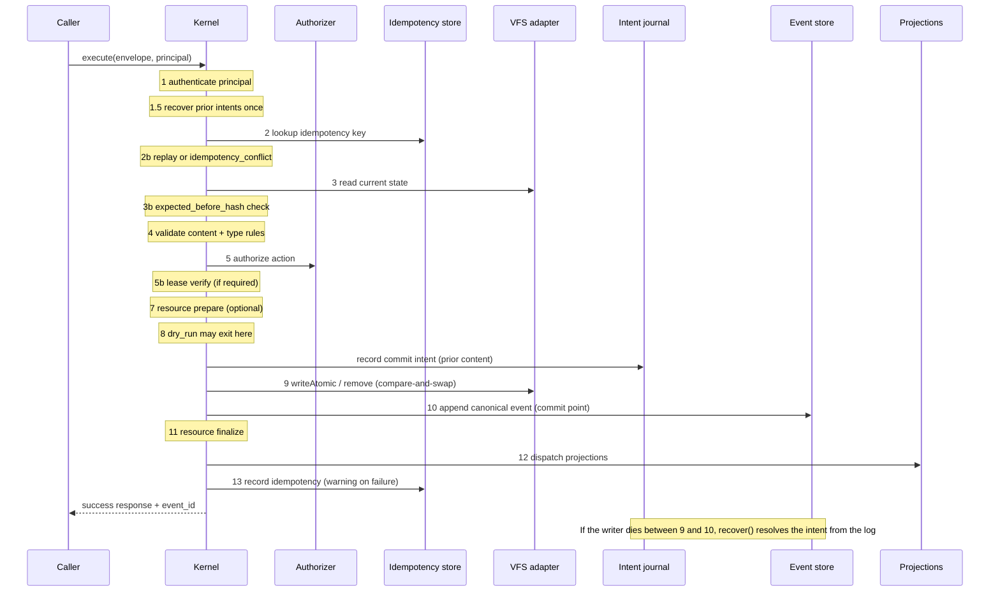
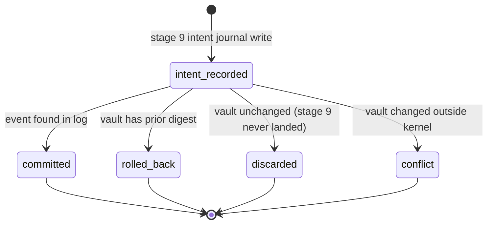

# Operation Contract & mutation kernel

The Operation Contract (spec §6) is the only path by which a Markdown vault is
mutated. A caller submits one of four envelope types — `operation`, `patch`,
`event`, or `delete` — and the shared mutation kernel in
<!-- openwiki: broken internal link [../src/kernel.mjs] file "../src/kernel.mjs" does not exist. Fix the href or restore the target, then delete this comment. -->
[`src/kernel.mjs`](../src/kernel.mjs) owns the ordering and semantics that turn
that envelope into either a committed canonical event or a symbolic failure code.
Adapters (VFS, event store, idempotency store, lease store, authorizer,
projection coordinator, resource coordinator) implement mechanics only; the
kernel owns the pipeline. Nothing above the kernel performs mutation; nothing
below it defines semantics. See [SSSS system architecture](../architecture.md)
for where the kernel sits in the stack.

## The four envelope types

| Envelope | Purpose | VFS effect |
|---|---|---|
| `operation` | Full atomic file write — create or full replace | `vfs.writeAtomic` (create with `ifAbsent`, or replace with a version) |
| `patch` | Partial merge into an existing file | `vfs.writeAtomic` with the current version as precondition |
| `event` | Append-only immutable log entry; no document on disk | none — the event store append *is* the commit |
| `delete` | Tombstoning removal of a replace-type file | `vfs.remove` with the current version as precondition |

The contract primitives are declared in
<!-- openwiki: broken internal link [../registry/core.json] file "../registry/core.json" does not exist. Fix the href or restore the target, then delete this comment. -->
[`registry/core.json`](../registry/core.json) under `contract_primitives`:
`operation`, `patch`, `event`, `delete`, and `lease`. An `operation` on a path
that ends with `/index.md` is a special case: the kernel resolves it to a
synthetic `index` definition (qualified `ssss:index`, no registry entry) and
writes the content verbatim without frontmatter validation, so a vault's index
page has no document-primitive `type`.

Every envelope carries `workspace_id`, `idempotency_key`, and `path` as required
string fields; `operation` requires a string `content`, `patch` requires a
`patches` object, and `event` requires its `content` (if present) to be valid
JSON. A missing or malformed field is rejected at the top of `execute` with
`invalid_request` and field-level repair hints before any storage is touched.

## The `kernel.execute` pipeline

`createKernel(options)` returns `{ execute, recover, registry, validator }`.
The stages of `execute(envelope, context)` are, in order:

*Figure: the Operation Contract commit pipeline. Stages 1–8 abort cleanly on
failure; stage 10 is the commit point; stages 11–13 are compensated forward as
warnings, never rolled back.*

### Stage 1 — Authenticate before storage

The very first storage-bound check verifies a principal with a string `id` and
`kind` (one of `human`, `agent`, `service`, `system`) and an `authentication`
provenance. A missing or malformed principal returns `unauthorized`, never
`forbidden`, because an absent identity is an authentication failure, not a
permission decision. Authentication runs before the vault is read, so an
anonymous caller learns nothing about its contents. The principal's `id` is part
of the idempotency request hash, so a key replayed by a different principal is a
conflict rather than a disclosure.

`recoverOnce()` runs once per kernel before its first operation, so a
commit intent a crashed writer left behind is rolled back even on paths nobody
writes again.

### Stage 2 — Idempotency replay vs. conflict

The kernel computes `canonicalRequestHash(envelope, principal)` — a stable
SHA-256 over the envelope's `type`, `workspace_id`, `idempotency_key`, `path`,
`primitive_type`, `content`/`patches`, `expected_before_hash`, and the
principal's `verified_principal_id`. It then looks up
`(workspace_id, idempotency_key)`:

- A **stored result** with a **matching** request hash is replayed as-is
  (`replay: true`). A matching hash means the same caller is retrying the same
  request — return the original response.
- A stored result or log event with a **different** request hash returns
  `idempotency_conflict`: the same key was already used for a different request.
- A cache **miss** falls through to the event store's
  `findByIdempotencyKey`. The event log is the durable record — every committed
  event carries its `idempotency_key` and `request_hash` — so a cache miss after
  retention, a lost record, or a new process still finds the commit and replays
  it (with a backfill of the cache). The idempotency store is *only* a cache; the
  log is the source of truth.

This is the key distinction: **replay** (same key, same request hash → return
the prior result) vs. **conflict** (same key, different request hash → refuse).
A retry of the same request after the cache expired is resolved from the log,
not re-executed.

### Stage 3 — Read state and version precondition

The kernel reads the current file through the VFS. If `expected_before_hash` is
set, it is compared to the current hash; a mismatch is `version_conflict` (unless
the content is byte-identical, which is treated as an unchanged no-op). A VFS path
error (`VfsPathError` / `SSSS_VFS_PATH`) maps to `invalid_request`; any other
VFS error maps to `internal_error`.

### Stage 4 — Validation and type rules

Content is validated against the registry (`src/validator.mjs` resolves the
declared `type` through `src/registry.mjs`). The kernel enforces:

- **Type immutability.** An `operation` may not change an existing document's
  primitive type — `validation_failed` with a "Use an explicit migration" hint.
  A `patch` may not change the `type` field to a different primitive type, and
  may not change any field the registry marks `immutable_fields`.
- **Append-only protection.** A primitive whose registry `append_only` is true
  (`conversation`, `run`, `thread`) cannot be replaced by an `operation` or
  removed by a `delete`; it can only be extended by a `patch` carrying
  `__body__`, which appends to the existing body. A replace attempt returns
  `validation_failed`; a delete returns `validation_failed`.
- **Unchanged no-op.** Replaying an `operation` whose content is byte-identical
  to the current file is an `unchanged` no-op, not a replace — checked *before*
  the append-only guard so re-importing an already-present bundle reports
  `unchanged` instead of failing. This requires authorization (the caller must
  be permitted to `replace`) but returns the existing `committed_at`.
- **Upgrade guard.** When `intent === 'upgrade'`, a `tenant_private` document is
  immutable — the kernel returns `forbidden` before commit.

### Stage 5 — Fail-closed authorization

Authorization runs after validation and before commit. The default authorizer
(`createCapabilityAuthorizer()` in `src/authorization.mjs`) is fail-closed: a
missing or malformed principal is denied, never silently promoted to a default
role.

The authorization model is the 0.9 **capability model**:

1. **Verified principal.** `validateVerifiedPrincipal` requires a principal
   with a string `id`, a `kind` in `{human, agent, service, system}`, an array
   `workspaceIds`, and an `authentication.provider`. A principal whose `kind` is
   not `system` must be scoped to the request's `workspaceId`.
2. **Required capabilities.** `requiredCapabilities(definition, action)` returns
   the capabilities a primitive's registry `definition.capabilities[action]`
   declares, falling back to `<qualified_type>:<action>` (or `<type>:<action>`)
   when none are declared. For `event` envelopes, the synthetic definition
   declares `capabilities: { event: ['write:event'] }`, so an event requires
   `write:event` specifically — a `write:<some document type>` capability does
   not satisfy it.
3. **`capabilityCovers`.** A granted capability covers a required one by exact
   match, `*:*` (full access), or a trailing-`*` prefix (`ssss:*` covers every
   core capability; `ssss:assistant:*` covers every action on assistants).
   Optionally a capability may be scoped to a path glob with `@<glob>`, e.g.
   `ssss:rule:*@rules/marketing/**`, which is matched against `context.path` via
   `matchPathGlob` (with `**` for any-depth and `*` for a single path segment).
4. **Policy floors.** `createCapabilityAuthorizer({ policyFloors })` merges
   registry-declared floor capabilities into the required set for a given
   action, so a policy floor can *raise* the bar but a primitive can never
   weaken a floor below what the registry declares (validated at compose time by
   `composeRegistryLayers`).
5. **Aliases.** When a primitive declares `aliases`, the authorizer also accepts
   a capability granted under an alias's qualified or bare form.
6. **System bypass.** A principal with `kind === 'system'` bypasses capability
   checks entirely unless `systemBypass === false` was passed at authorizer
   construction.
7. **Context gates.** `context.requiresHumanConfirmation` requires a `human`
   principal with `humanConfirmation === true`; `context.requiredAssurance`
   requires an authentication assurance level at least as strong as the named
   level (`unverified < verified < elevated < hardware`).

A denial returns `{ allowed: false, reason }`; the kernel maps it to
`unauthorized` when the principal failed validation and `forbidden` otherwise.

### Stage 6 — Lease

When `definition.lease_required` is true or `context.requireLease` is set, and a
`leaseStore` is configured, the kernel calls `leaseStore.verify` with the
workspace, target path, principal id, operation id, and `lease_id`. A missing,
expired, or mismatched lease returns `lease_conflict` (spec §7). An unreadable
lease store returns `internal_error`.

### Stages 7–8 — Resource prepare and dry run

If a `resourceCoordinator` with `prepare` is configured, it runs before commit;
its state is passed to `finalize`/`reconcile` later. A `dry_run` envelope
returns a success response with `committed_at: null` and `dry_run: true` after
validation and authorization, without writing anything.

### Stage 9 — VFS compare-and-swap commit

For `operation`, `patch`, and `delete`, the kernel performs the VFS write under
a durable **commit intent** recorded by the intent journal (`src/intents.mjs`).
The intent holds the path's prior content (as base64 bytes), the intended
after-digest, and the `event_id` the commit will append. The journal holds the
path's commit lock until stage 10 ends, so commits on one path are serialized.
An `event` envelope has no VFS commit, so it skips the intent.

### Stage 10 — Event append (the commit point)

The canonical event (`createCanonicalEvent` in `src/events.mjs`) is the **commit
point**: nothing after it may roll the mutation back. The event records
`event_id`, `workspace_id`, `primitive_id`, `action`, `subject`, `principal`,
`operation_id`, `idempotency_key`, `request_hash`, `before_hash`/`after_hash`,
`changed_fields`, and `payload`. For `event` envelopes the `event_id` is
deterministically derived from `(workspace_id, idempotency_key)` via
`idempotentEventId` (UUIDv5), so the event store's duplicate-`event_id` check
stops two concurrent requests with the same key from both appending.

If the event append fails *after* the VFS write succeeded, the kernel rolls the
VFS back to the prior content. If that rollback also fails, the intent is kept
(`keepIntent: true`) so the next commit on the path (or `recover()`) finishes
the rollback, and the response is `internal_error`. A concurrent same-key winner
that already committed is returned as a replay.

### Stages 11–13 — Post-commit compensation

After the event is appended, failures fail *forward* as warnings, never
rollbacks, because the log already says the mutation happened:

- **11. Resource finalize.** If `resourceCoordinator.finalize` throws, it is
  reconciled and the error becomes a warning.
- **12. Projections.** `projectionCoordinator.dispatch(event)` failures become
  warnings; projections are disposable and rebuildable from the log.
- **13. Idempotency record.** Caching the response in the idempotency store is
  best-effort; a failure becomes a warning.

The success response carries `event_id`, `committed_at`, and
`validation.type` (the primitive's `qualified_type`).

## Crash recovery and commit intents

For every non-`event` envelope the kernel durably records a commit intent
before the stage-9 VFS write. If the writer dies between stages 9 and 10,
`recover()` (run once per kernel before its first operation, and before the next
commit on the affected path) resolves each leftover intent:

*Figure: the four outcomes `resolveIntent` may return for a commit intent whose
writer is gone. The event is the commit point: if it is in the log the commit
stands; if not, the vault is returned to its prior content.*

The decision is made from the event log and the vault's current digest — both
computed by the kernel over raw bytes — so it does not depend on a VFS's version
scheme. A `failed` outcome keeps the intent for a later attempt; a `conflict`
quarantines the intent (in `FileIntentJournal`) under `unresolved/` so it is not
silently lost. A live writer's intent is never touched: the intent journal's
per-path lock and the `INTENT_LOCK_DEFAULTS` (40 s timeout, 5 min stale
threshold) ensure recovery never rolls back a commit that is still running.

<!-- openwiki: broken internal link [../workflows/mutation-commit.md] file "../workflows/mutation-commit.md" does not exist. Fix the href or restore the target, then delete this comment. -->
See [Mutation commit](../workflows/mutation-commit.md) for the operational view
of this pipeline.

## The legacy role → capability translation

`src/engine.mjs` is a compatibility façade for the pre-0.9
`createEngine().processOperation()` API. It contains no second mutation
implementation: `createEngine()` builds a `createKernel()` per
`(vaultRoot, eventLogDir)` pair and forwards every envelope to
`kernel.execute()`. Its only added behavior is **legacy principal translation**:

- `actor.role === 'system'` → a `system` principal with `*:*` (unconditional
  bypass, not data-driven; there is no `roles/system/ROLE.md`).
- `actor.role === 'admin'` → a `human` principal with `*:*` (hardcoded, regardless
  of what `roles/admin/ROLE.md` says — a file there can only add, never restrict).
- Any other role name → read `roles/<role>/ROLE.md` from the target vault and
  translate its `permissions` via `legacyRoleCapabilities` into 0.9
  capabilities. A missing role file means zero permissions.
- *(absent `actor.role`)* → `null` principal → the kernel denies with
  `unauthorized`. A missing role is not a default; it is a failure. A host that
  exposes the Operation Contract to untrusted clients **must** overwrite `actor`
  with verified session identity before the envelope reaches the engine.

`legacyRoleCapabilities` maps the pre-0.9 permission grammar (`write:<type>`,
`*:<type>`, `write:*`, `*:*`) into the 0.9 capability form
(`<qualified_type>:<action>`), expanding aliases so a role that granted
`write:workflow` yields `ssss:workflow:*` and any alias forms. Unknown types and
`read:*` pass through unchanged, which grants nothing extra. The engine also
strips the `ssss:` qualifier from `response.validation.type` for backward
compatibility.

## Symbolic ERROR_CODES and HTTP status

Every failed response carries exactly one symbolic code in `error.code`; the
message is informational. The kernel exports the frozen `ERROR_CODES` array:
`invalid_request`, `unauthorized`, `forbidden`, `not_found`, `lease_conflict`,
`version_conflict`, `idempotency_conflict`, `validation_failed`,
`internal_error`. Transports map codes to HTTP status without parsing messages:

| Code | HTTP | Meaning |
|---|---|---|
| `invalid_request` | 400 | Malformed envelope or VFS path error |
| `unauthorized` | 401 | Missing/invalid verified principal |
| `forbidden` | 403 | Principal valid but lacks capability or upgrade guard |
| `not_found` | 404 | Patch or delete target does not exist |
| `lease_conflict` | 409 | Missing, expired, or mismatched lease |
| `version_conflict` | 409 | `expected_before_hash` or VFS compare-and-swap mismatch |
| `idempotency_conflict` | 409 | Same key used for a different request |
| `validation_failed` | 422 | Registry validation or type-rule failure |
| `internal_error` | 500 | Unrecoverable store, commit, or recovery failure |

The mapping lives in `src/http.mjs` as `ERROR_STATUS`, and
`statusForResponse(response)` returns `201` for a fresh commit, `200` for a
replay or dry run, and `ERROR_STATUS[code] || 500` otherwise. A transport
(`createCommandHandler`) authenticates a request, parses the envelope, forwards
it to `kernel.execute`, and maps the response — it is never a writer.

## Adapters and extension points

`createKernel` takes injectable adapters (spec §6.7), each with a reference
implementation in `src/`:

- **VFS** (`src/vfs.mjs`) — `MemoryVfs` / `FileSystemVfs`; compare-and-swap
  `writeAtomic`/`remove` with path safety, reserved directories
  (`.ssss-locks`, `.ssss-intents`), and durable `fsync` writes. A VFS whose state
  outlives the process supplies its own intent journal
  (`vfs.intentJournal()`), so hosts get crash recovery without wiring one.
- **Event store** (`src/events.mjs`) — `MemoryEventStore` / `JsonlEventStore`;
  the append-only, idempotency-key-indexed log. `JsonlEventStore` rotates at a
  configurable byte cap and indexes across live + archive segments.
- **Idempotency store** (`src/idempotency.mjs`) — `MemoryIdempotencyStore` /
  `FileIdempotencyStore`; a cache of full responses with bounded retention
  (24 h default) and opportunistic pruning.
- **Lease store** (`src/leases.mjs`) — `MemoryLeaseStore` / `FileLeaseStore`;
  optimistic concurrency leases (§7), fail-closed on corrupt state.
- **Authorizer** (`src/authorization.mjs`) — `createCapabilityAuthorizer`; a
  host may inject its own `authorize` function or configure `policyFloors` and
  `systemBypass`.
- **Projection coordinator** — optional; dispatches the committed event to
  disposable, rebuildable projections.
- **Resource coordinator** — optional host hook for external resources, with
  `prepare`/`finalize`/`reconcile` around the commit.

A host extends SSSS by composing an extension registry and injecting adapters
that satisfy these contracts; it never forks the kernel. See
[Registry & portability](registry-and-portability.md) and
[Host adapters](../integrations/host-adapters.md).

## See also

- [SSSS system architecture](../architecture.md) — where the kernel sits in the
  stack and the vault → bundle → tenant lifecycle.
- [Bundle format & provisioning contract](bundle-and-provisioning.md) — the
  `.ucw` bundle and the `import`/`upgrade` verbs that replay envelopes through
  the kernel idempotently.
- [Registry & portability](registry-and-portability.md) — the primitive
  definitions (`append_only`, `immutable_fields`, `portability`) the kernel
  enforces.
- [Host adapters](../integrations/host-adapters.md) — the VFS, event, lease, and
  idempotency adapter contracts.
<!-- openwiki: broken internal link [../workflows/mutation-commit.md] file "../workflows/mutation-commit.md" does not exist. Fix the href or restore the target, then delete this comment. -->
- [Mutation commit](../workflows/mutation-commit.md) — the operational view of
  this pipeline.
<!-- openwiki: broken internal link [../docs/help/roles.md] file "../docs/help/roles.md" does not exist. Fix the href or restore the target, then delete this comment. -->
- [`docs/help/roles.md`](../docs/help/roles.md) — the fail-closed RBAC model and
  the `system`/`admin`/absent role behaviors.
