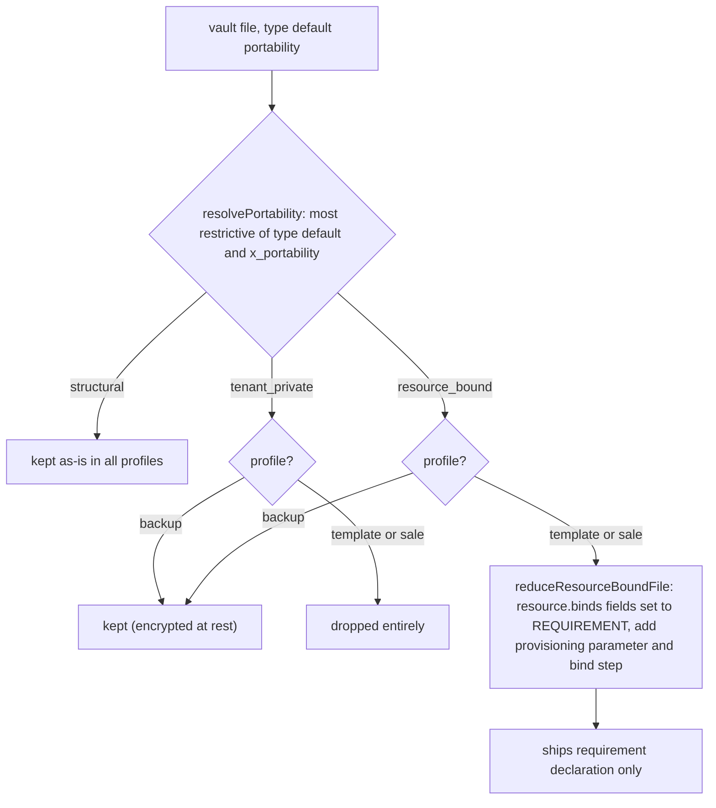

# Registry, portability & schemas

The engine has **no per-type code**. Every document primitive — its `required_fields`,
`optional_fields`, `immutable_fields`, `required_when` conditions, `enums`, `patterns`,
`references`, `append_only` flag, `portability` class, and `resource.binds` metadata — is
declared as data in `registry/core.json` plus extension registries, and resolved at runtime by
`src/registry.mjs`. This is the validation authority for spec §5/§9: a file validates exactly
when its registry-declared constraints are satisfied, so core conformance reduces to "the
registry says so" rather than a per-type handler per host.

This page covers four things that all flow from that registry:

1. **Composition & resolution** — how core + extensions are composed into a runtime type table, how aliases and qualified names resolve, and how extension requirements are enforced.
2. **Portability** — the three portability classes, the `x_portability` override (most restrictive wins), and how export profiles filter classes into `backup`/`template`/`sale` bundles.
3. **The zero-dependency YAML frontmatter parser** and the **Draft 2020-12 JSON Schemas + zero-dependency schema validator** that govern the registry and bundle shapes.
4. **The primitive-definition API** that lets an extension author a rich primitive and compile it down to an executable registry entry.

Related: [Bundle format & provisioning](bundle-and-provisioning.md) consumes the registry to
filter and reduce files during export; [Operation contract](operation-contract.md) validates
envelopes through the same `validateDataConstraints` path.

## The registry document

`registry/core.json` is the canonical machine-readable core. It is the single source of truth
that every conformant host maps to (see `conformance/README.md`). It declares:

- **`document_primitives`** — the core document types (`memory`, `skill`, `asset`, `resource`,
  `rule`, `role`/`security_role`, `task`, `assistant`, `workflow`, `trigger`, `model`,
  `thread`/`conversation`, `run`, `conflict`, `page`, `migration`, `release`, `primitive`).
  Each carries `family`, `append_only`, `portability`, `required_fields`, and optionally
  `optional_fields`, `required_when`, `enums`, `patterns`, `immutable_fields`, `references`,
  `aliases`, `resource`, `deprecated`/`deprecation_notice`.
- **`contract_primitives`** — the five Operation Contract envelopes (`operation`, `patch`,
  `event`, `delete`, `lease`). These are protocol envelopes, not stored documents, and carry no
  portability class.
- **`portability`** — the three classes and the three export profiles (the keystone; see below).
- **`bundle`**, **`provisioning`**, **`runtime`**, **`semantic`** — the vocabularies for the
  bundle format, provisioning steps, workflow runtime, and semantic layer.
- **`universal_frontmatter`** — the required/recommended frontmatter fields every document
  shares (`type`, `title`, `description`, `timestamp`).
- **`reserved_keys`** and **`host_field_prefix`** (`x_`) — keys the host owns; extensions must
  not redefine them.

Core primitives are qualified as `ssss:<name>`; applications define namespaced primitives
(`<registry>:<name>`) through layered extension registries **without copying or redefining
core behavior**.

## Composition & type resolution

`composeRegistries({ core, extensions })` in `src/registry.mjs` is the runtime composition
path. Hosts never copy `core.json` into their own repos; the package core is always loaded and
extensions are merged on top. Composition performs these checks:

- **Portability classes are non-empty.** The set of classes is read from
  `core.portability.classes`; every primitive's `portability` must be one of them.
- **Each primitive definition is validated** by `validatePrimitiveDefinition` (in
  `registry.mjs`, distinct from the primitive-authoring validator in `primitive.mjs`): it
  enforces safe type/field names, boolean `append_only`, valid `required_when` condition
  syntax (`field==value`), compilable `patterns` (compiled as `new RegExp(pattern, 'u')`),
  unique enum values, and well-formed `references` (`allowed_types`/`disallowed_types` with no
  overlap, `allowed_portability` drawn from the class set, optional `must_exist` and
  `hash_field`).
- **Aliases resolve bidirectionally and collide-check.** `role` aliases `security_role` and
  vice-versa; an alias that collides with an existing primitive name is a hard error unless the
  two primitives mutually alias each other. Both bare (`security_role`) and qualified
  (`ssss:security_role`) forms are registered.
- **Extension namespaces are enforced.** An extension registry name must be a safe identifier,
  must not be `core`/`ssss` or duplicate another extension, and its primitives must use the
  extension's namespace prefix when qualified. A primitive that collides with a core type, an
  alias, or another extension's primitive is a load-time collision (§5.6) — a hard error, never
  a silent preference.
- **`requires` is semver-checked.** Each extension may declare `requires` mapping a dependency
  registry name to a semver range (`*`, exact, `^`, or `~`); after all extensions are loaded,
  every dependency must be present and satisfy its range.
- **Reference targets must exist.** After composition, every `allowed_types`/`disallowed_types`
  entry in every primitive's `references` must name a known primitive (directly or via alias),
  and allow/forbid sets must not overlap *through aliases* (`isSamePrimitiveType`).

The returned `registrySet` carries: `types` (a `Map` keyed by bare name, with each value
annotated with `type`, `qualified_type`, and `registry`), `aliases` (bare and qualified →
canonical), `contractTypes`, `portabilityClasses`, `core`, `extensions`, and
`extensionVersions`. For backward compatibility the alias table is also attached as
`types.aliases` so existing engine/bundle APIs that receive only the `types` Map can still
resolve qualified 0.9 identifiers.

### Loading from disk

`loadRegistries(registryDir, options)` reads `core.json` and the `extensions/` directory. An
application `registry/` directory may hold only `extensions/` (no `core.json`); in that case
the package core is used automatically. Extension files must be regular (non-symlinked) JSON;
symlinked registries are rejected.

Because a registry directory may accumulate one extension per unrelated product, and two
products may legitimately declare the same shared primitive name (e.g. both a CRM and a
ticketing product needing `integration_connection`), loading every extension together can be a
load-time collision. Two scoping mechanisms handle this:

- **`extensions/defaults.json`** — a manifest naming the set of extensions safe to compose
  together. When present and the caller does not pass `only`, exactly that set is loaded.
- **`options.only`** — a caller that owns a specific vault's extensions passes an explicit set
  (e.g. `['example-app']`); only those are loaded, and any named extension not present on disk is a
  hard error.

Without either, every extension is loaded and any duplicate name remains a hard error.

### Layered composition & policy floors

`composeRegistryLayers({ core, installed, repository, workspace, user, policyFloors })`
composes named ownership layers (installed → repository → workspace → user) without giving
lower scopes override semantics — it is still a flat composition, just with source labels. It
additionally enforces **policy floors**: for each named primitive/action, the primitive's
declared capabilities must be a superset of the floor's required capabilities, so a layer
cannot weaken a policy floor.

### Registry locks

`createRegistryLock(registrySet)` produces a stable, content-addressed lock: primitives sorted
by `qualified_type`, extension versions sorted, and a `sha256:` integrity digest over the
canonical (key-sorted) JSON. `verifyRegistryLock(registrySet, lock)` recomputes and compares
the digest, so a vault can pin the exact registry state it was authored against.

## Portability — the keystone

Every document primitive declares one of three **portability classes** (§5.5). This is what
makes a vault sellable without leaking the operator's private data.

| Class | Meaning | Core examples |
|-------|---------|---------------|
| `structural` | The reusable business model — sellable and templatable. Carries no operator- or customer-specific data. | `workflow`, `rule`, `assistant`, `page`, `skill`, `memory`, `migration` |
| `tenant_private` | The operator's private operational data. **Never** sold or templated; included only in an encrypted backup. | `task`, `thread`/`conversation`, `run`, `conflict` |
| `resource_bound` | Needs a real external resource bound at provision time (domain, phone number, mailbox, API connection). Never ships the seller's bound value. | `resource`; extension types like `domain`, `phone_number`, `integration_connection` |

Contract primitives (`operation`/`patch`/`event`/`delete`/`lease`) are protocol envelopes,
not stored documents, and carry no portability class.

### `x_portability` override — most restrictive wins

A file MAY override its type's default class with an `x_portability` frontmatter field.
`resolvePortability(typeDef, frontmatter)` in `src/registry.mjs` computes the effective class
as the **most restrictive** of the type default and the instance override, using the order
`structural` (0) → `resource_bound` (1) → `tenant_private` (2). An override can only ever
*escalate* restrictiveness, never relax it: a `structural` type marked `x_portability:
resource_bound` becomes `resource_bound`, but a `tenant_private` type marked
`x_portability: structural` stays `tenant_private`.

This is how an `asset` with `encoding: none` — a pointer to a large file rather than inline
content — is forced to `resource_bound` (or `tenant_private`) so the seller's `storage_uri`
is never shipped; the core registry's `asset` definition encodes this directly via its
`required_when` and `enums` for `x_portability`.

### Export profiles are filters over the classes

| Profile | Includes | Use |
|---------|----------|-----|
| `backup` | structural + tenant_private + resource_bound | Full operator backup/restore; `tenant_private` MUST be encrypted at rest. |
| `template` | structural + resource_bound | A reusable template; private data stripped. |
| `sale` | structural + resource_bound | A tradeable business; private data stripped. |

`template` and `sale` share the same class filter; the semantic difference is intent (reusable
template vs. tradeable business). For both, an exporter MUST:

1. **Drop every `tenant_private` primitive** entirely. A host MUST reject a `template`/`sale`
   export that would emit a `tenant_private` primitive.
2. **Reduce every `resource_bound` primitive to a requirement declaration**, stripping the
   seller's actual bound value (domain, phone number, provider, connection).

### How `resource_bound` fields become `REQUIREMENT` placeholders

The exporter (`exportBundle` in `src/bundle.mjs`) uses the extension registry's
`resource.binds` metadata — the list of field names that hold a bound resource value. For each
`resource_bound` file in a `template`/`sale` export:

- `reduceResourceBoundFile` parses the document, sets `x_portability: 'resource_bound'`, and
  replaces every field listed in `resource.binds` with the literal string `REQUIREMENT`.
- `ensureRequirementDeclarations` adds a provisioning **parameter** (source `user`, scope
  `workspace`) for each bound field, keyed by `<type>_<field>`, plus a provisioning **step**
  (`id: bind-<type>`, `mode: provision`, `required: true`) whose `system` is derived from
  `resource.kind` (e.g. `domain` → `domains`, `phone_number` → `phone`, `api_connection` →
  `automation`).
- If a `resource_bound` type declares no `resource.binds`, export throws: it cannot be reduced
  safely.

At provision time (`provisionBundle`), each `REQUIREMENT` value is resolved against the
caller's parameters — the exporter generates well-known parameter aliases (e.g. `domain` for a
`domain.domain_name` field, `phone` for `phone_number.phone_number`) — and the resolved value
replaces the placeholder before the file is committed. An unresolved *required* binding is a
provision error.

Bundle validation (`validateBundle`) independently re-checks the guarantee: for every
`resource_bound` file in a `template`/`sale` bundle, every `resource.binds` field MUST equal
`REQUIREMENT`, or the bundle is rejected for leaking a seller-bound value.



*How a file's resolved portability class routes it through an export profile (§5.5).*

### The reference bundle proves both guarantees

`conformance/reference-bundle.ucw.json` is the canonical "Festival in a Box" `sale`-profile
bundle. Its `primitive_inventory` contains only structural and `resource` types — no `task`,
even though the source vault's `tasks/` index references a ticket. Its `resources/domain.md`
carries `binds: REQUIREMENT` and `x_portability: resource_bound`, and the manifest declares a
`domains` provisioning step and a `domain` parameter the buyer supplies. The conformance runner
round-trips this bundle (validate → provision → import → re-import) to prove idempotency and
that no `tenant_private` or seller-bound `resource_bound` value ever lands.

## Field-level validation

`validateDataConstraints(typeDef, data, universalRequired)` in `src/registry.mjs` is the
shared field-level validator used by the engine, bundle transport, and semantic projections.
It checks, entirely from registry data:

- **Required fields** — universal frontmatter required (`type`, `title`, `description`,
  `timestamp`) plus the type's `required_fields`. "Required" means present: an empty array
  (e.g. `deferred_steps: []`) is a valid value, not missing.
- **`required_when`** — conditional requirements keyed by `field==value`; when the named field
  equals the expected value (numeric or string), the listed fields become required. The core
  `memory` primitive uses `schema_version==2` to require the full semantic-triple fields.
- **`enums`** — field values (scalar or array) must be in the registry's allowed list.
- **`patterns`** — string field values must match the registry's `u`-flagged regular
  expression.

`validateReferenceConstraints(typeDef, data, resolveReference, types)` validates
registry-declared document **references** using a caller-provided resolver (so the same checks
serve the Operation Contract, bundles, and projections). For each reference field it checks:

- the path is a safe vault-relative path (`isSafeDocumentPath` — no absolute paths, no `..`,
  no backslashes, no NUL);
- the referenced document exists (unless `must_exist: false`);
- the referenced document's type is known and satisfies `allowed_types` /
  `disallowed_types` (compared via `isSamePrimitiveType`, so aliases are honored);
- the referenced document's resolved portability is in `allowed_portability` when declared;
- when `hash_field` is set, the referenced document's `documentHash` (sha256 over its content)
  matches the value in the named field — binding derived/translated documents to an exact
  source.

### The validator façade

`src/validator.mjs` is the shared validation surface every host uses:

- **`validateData(data, options)`** — resolves the declared `type` against the registry, runs
  `validateDataConstraints`, and (for `type: primitive`) also runs the primitive-authoring
  validator. It accepts a caller-provided `resolveReference` and `validateExtension` hook.
- **`validateDocument(content, options)`** — parses a full Markdown document with the
  frontmatter parser and delegates to `validateData`.
- **`createValidator(options)`** — binds a registry set once and returns `{ registry,
  validateData, validateDocument, resolve }` for reuse across many documents.

## The primitive-definition API

`src/primitive.mjs` is the authoring layer for extension primitives. A rich definition uses
human-facing `name`/`description` (any language) plus stable symbolic identifiers
(`primitive_id`, field `id`s, capability IDs) that are never translated. The API:

- **`definePrimitive(input, options)`** — normalizes an authored definition, generates missing
  stable IDs (`generatePrimitiveId` hashes `namespace + name` to a `namespace:p_<digest>` ID;
  field IDs hash `primitive_id + field name`), applies defaults (`mutation: replace`,
  `portability: structural`, `scopes: ['workspace']`), and validates.
- **`validatePrimitiveDefinition(definition)`** — the authoring validator: required top-level
  fields, safe namespace/symbol regexes, positive integer `version`/`revision`, valid
  `mutation`/`portability`/`scopes`, unique field IDs, valid `FIELD_KINDS`, unique enum
  values, compilable patterns, qualified capability IDs, and safe `aliases`.
- **`primitiveDefinitionToRegistryEntry(definition)`** — compiles a rich definition into the
  executable registry shape: splits fields into `required_fields`/`optional_fields`,
  materializes `enums`/`patterns`/`references`, sets `append_only` from `mutation`, and
  carries through `scopes`/`capabilities`/`events`/`projections`/`ui`/`aliases`/`migrations`.
- **`definitionsToExtensionRegistry(namespace, definitions, options)`** — packages one or more
  definitions into an extension registry object (`{ registry, extends: 'ssss', version,
  requires, document_primitives }`) ready for `composeRegistries`.

The core `primitive` document type is itself a governed, versioned primitive definition stored
in the vault (`primitives/<namespace>/<id>.md`), with `immutable_fields: ['primitive_id',
'namespace']` and patterns governing `primitive_id`, `namespace`, and `language`. When
`validateData` sees `type: primitive`, it additionally runs the authoring validator on the
document's own definition.

## The zero-dependency frontmatter parser

SSSS files are Markdown with a leading `---`-fenced YAML frontmatter block (§4.1). The
canonical engine avoids a YAML dependency: `src/frontmatter.mjs` parses only the subset SSSS
actually uses (§4.5) — scalars, inline `[a, b]` arrays and `{k: v}` maps (JSON/YAML flow
style), block `- item` arrays, nested maps, arrays of shallow maps, and `|`/`>` block scalars
with clip/strip/keep chomping. This is sufficient to resolve a file's `type`, validate registry
fields, and round-trip operation patches without dropping nested frontmatter.

Key behaviors:

- **`splitFrontmatter(content)`** — splits a document into raw frontmatter and body, first
  repairing documents a broken writer flattened onto one line with literal `\n` text
  (`repairEscapedNewlines`).
- **`parseFrontmatter(fm, { strict })`** — lenient by default (unreadable lines skipped);
  `strict: true` throws `SyntaxError` on non-`key: value` lines, orphaned indentation, and
  malformed quoted/inline values, so callers can report unreadable files.
- **`parseDocument(content)`** — `{ data, body }` for a full fenced document.
- **Type coercion** — plain scalars coerce to boolean/null/integer (a leading zero like `07003`
  marks a code, not a number)/float/hex/octal; double-quoted scalars decode JSON-string
  escapes (a superset); single-quoted scalars use `''` escaping. A `# comment` may trail an
  unquoted value.
- **`serializeDocument(data, body)`** — round-trips an object back into a fenced document,
  quoting values that would otherwise read back as a different type (so `"07003"` and `"true"`
  survive), and emitting nested objects/arrays in block style.

The serializer is what `reduceResourceBoundFile` uses to rewrite a `resource_bound` file with
`REQUIREMENT` placeholders during export, and what `provisionBundle` uses to rewrite resolved
parameter values back into a document during provisioning.

## JSON Schemas & the schema validator

Two canonical Draft 2020-12 JSON Schemas govern the registry and bundle shapes:

| Schema | Path / export | Governs |
|--------|---------------|---------|
| Core & Extension Registry | `@gregiteen/ssss-cli/schemas/core-registry.schema.json` | `registry/core.json`, `registry/extensions/*.json`, and runtime extension registries (§5). |
| `.ucw` Bundle | `@gregiteen/ssss-cli/schemas/bundle.schema.json` | `.ucw` transport bundle containers and manifests (§16). |

Both enforce `"additionalProperties": false` on structured objects so unknown or misspelled
properties fail closed. The registry schema's `primitiveDefinition` `$def` mirrors exactly the
fields the runtime validator checks: `required: [family, append_only, portability,
required_fields]`, with `required_when` condition keys matching `^[A-Za-z_][A-Za-z0-9_-]*==.+$`,
`references` constraints (`allowed_types`/`disallowed_types`/`allowed_portability`/`must_exist`/`hash_field`),
and the `resource` sub-object (`kind`, `binds`, `provision_relation`). The bundle schema
constrains the manifest's required fields, `export_profile` to `backup|template|sale`,
`primitive_inventory` as type→integer counts, provisioning steps (`system`/`mode` enums), and
parameters (`source` enum).

### Zero-dependency schema validator

`src/schema-validator.mjs` is a dependency-free Draft 2020-12 validator. It implements the
constructs SSSS schemas use: `type` (single or union), `const`/`enum`, `properties`,
`additionalProperties`/`propertyNames`, `required`, `items`/`minItems`/`maxItems`/`uniqueItems`,
`minLength`/`maxLength`/`pattern` (Unicode-aware via the `u` flag), `minimum`/`maximum`,
`allOf`/`anyOf`/`oneOf`, `if`/`then`/`else`, and local root-anchored `$ref` pointers (`#/...`)
evaluated alongside sibling keywords (with cycle protection via a `seenRefs` set). It returns
`{ valid, errors }` with path-tagged errors.

The programmatic API:

```js
import {
  getCoreRegistrySchema,
  getBundleSchema,
  validateRegistryAgainstSchema,
  validateBundleAgainstSchema,
  validateJsonSchema,
} from '@gregiteen/ssss-cli/schema-validator';

const { valid, errors } = validateRegistryAgainstSchema(myExtensionRegistry);
```

`getCoreRegistrySchema()` / `getBundleSchema()` read and cache the canonical schema files.
`validateRegistryAgainstSchema` and `validateBundleAgainstSchema` are thin wrappers over the
generic `validateJsonSchema(data, schema, options)`. The CLI mirrors these as `ssss schema
core`, `ssss schema bundle`, `ssss schema export`, and `ssss schema validate`.

Note the two validation layers are complementary, not redundant: the JSON Schema validator
checks the *shape* of a registry or bundle document (property names, enums, required keys);
the registry runtime validator (`validateDataConstraints` / `validateReferenceConstraints`)
checks the *contents* of individual vault files against the types the registry declares. A
registry must pass the first to be loadable, and its primitives then drive the second.
