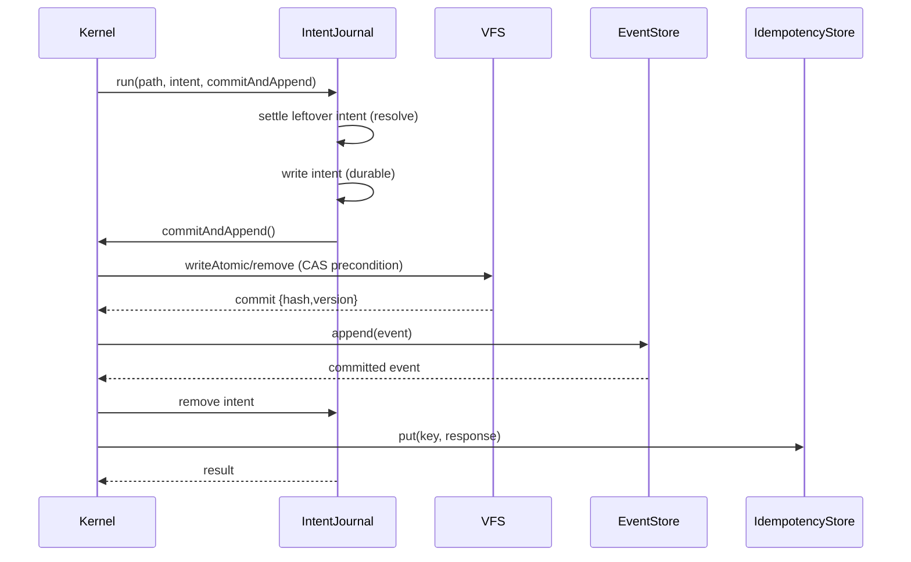

# Host adapter contracts

The SSSS kernel owns ordering and semantics; hosts own infrastructure. A host
constructs the kernel with injected adapters—`vfs`, `eventStore`,
`leaseStore`, `idempotencyStore`, `intentJournal`, and
`projectionCoordinator`—and the kernel drives them through narrow contracts.
This page documents each contract and the file-based reference
implementations shipped in `src/` (memory and filesystem variants), with the
cross-process file-lock semantics that make the filesystem variants safe to
share across processes on one filesystem. The kernel wiring is described in
[Architecture](../architecture.md) and the commit sequence in
[Mutation commit](../workflows/mutation-commit.md).

The commit sequence above: the VFS write (stage 9) is the persistence point for
document bytes; the event append (stage 10) is the irrevocable commit point.
The intent journal spans the window between them.

## Adapter inventory

| Adapter | Contract module | Memory impl | File impl | Lock file |
|---------|-----------------|-------------|-----------|-----------|
| VFS | `src/vfs.mjs` | `MemoryVfs` | `FileSystemVfs` | `<vault>/.ssss-locks/<sha256(path)>.lock` |
| Event store | `src/events.mjs` | `MemoryEventStore` | `JsonlEventStore` | `<events>/<workspace>.jsonl.lock` |
| Lease store | `src/leases.mjs` | `MemoryLeaseStore` | `FileLeaseStore` | `<leases>/<sha256>.lease.json.lock` |
| Idempotency store | `src/idempotency.mjs` | `MemoryIdempotencyStore` | `FileIdempotencyStore` | `<idempotency>/<sha256>.json.lock` |
| Intent journal | `src/intents.mjs` | `MemoryIntentJournal` | `FileIntentJournal` | `<intents>/<sha256>.lock` |
| Projection coordinator | `src/projections.mjs` | `ProjectionCoordinator` + in-memory adapters | — | (none) |
| UI projection registry | `src/ui.mjs` | `UiRegistry` | — | (none) |

Each filesystem adapter serializes its check-then-write critical section on a
per-key lock file created with `O_EXCL`, so concurrent writers on the same key
resolve to a single winner. The shared lock primitive lives in
`src/file-lock.mjs`.

## VFS adapter contract

The VFS is a content-addressed document store. Paths are vault-relative POSIX
paths validated by `isSafeDocumentPath` (no NUL, no backslash, no absolute
paths, no `.`/`..` segments). Every entry's `version` is its content hash
(`sha256:…`), which makes `version` preconditions compare-and-swap by content.

The contract (`runVfsContract` in `src/vfs.mjs`) asserts: a missing read returns
null; `writeAtomic` with `ifAbsent` creates; a stale `version` precondition
throws `VfsConflictError`; `append` preserves existing bytes; `remove` deletes;
and path traversal (`../escape.md`) is rejected with `VfsPathError`.

### Preconditions

`checkPrecondition` evaluates `ifAbsent`, `ifPresent`, and `version` against
the current entry. The kernel maps its commit types onto these:

- `operation` create → `ifAbsent: true`; `operation` replace → `version: current.version`
- `patch` → `version: current.version`
- `delete` → `version: current.version`

A failed precondition leaves no partial write: the lock is held for the whole
read-check-commit, so a second writer cannot observe a torn state.

### `FileSystemVfs` durability and hardening

`FileSystemVfs` writes through `writeAtomic`/`remove` under a per-path lock in a
reserved `.ssss-locks/` directory. The commit is durable before it reports
success:

1. `writeFileSyncDurable(temp, bytes)` — creates the temp file with
   `O_CREAT|O_EXCL|O_NOFOLLOW`, writes, and `fsync`s the file. `O_NOFOLLOW`
   refuses a symlinked temp target.
2. `fs.renameSync(temp, target)` — atomic rename.
3. `fsyncDirectory(path.dirname(target))` — flushes the directory so the rename
   survives an OS crash.

`fsyncDirectory` opens the directory read-only and `fsync`s it; platforms that
cannot sync a directory (Windows, returning `EISDIR`/`EINVAL`/`EPERM`/etc.) skip
the step rather than fail. `remove` likewise `fsyncDirectory`s the parent after
the `rmSync`.

Path hardening (`#resolve`): reserved directories (`.ssss-locks`,
`.ssss-intents`) are rejected case-insensitively; the resolved target must stay
under `root`; any symlink on the resolution path is rejected with
`VfsPathError`; and a parent that `realpath`s outside the root is rejected.
`list()` skips the reserved directories and throws on any symlinked entry.

### Reserved directories

`VFS_LOCK_DIR` (`.ssss-locks`) and `VFS_INTENT_DIR` (`.ssss-intents`) are
reserved. VFS paths whose first segment matches either (case-insensitively) are
rejected, and `list()` omits them. `.ssss-intents/` holds the co-located
intent journal (see below).

### `intentJournal()`

`FileSystemVfs.intentJournal()` lazily constructs and returns a
`FileIntentJournal` rooted at `<vault>/.ssss-intents`, using the VFS's
`intentLock` options. The kernel prefers `options.intentJournal`, then
`vfs.intentJournal?.()`, then a `MemoryIntentJournal`. This means a host that
injects a `FileSystemVfs` gets crash-recovering intent journals without wiring
one explicitly.

## Event store contract

The event store is an append-only log of canonical immutable events
(`createCanonicalEvent`). The contract obligations:

- **Append is idempotent by `event_id`:** a duplicate `event_id` throws. The
  kernel derives `event_id` for `event` envelopes from
  `idempotentEventId(workspace_id, idempotency_key)`—a UUIDv5 over a fixed
  namespace—so two concurrent requests with the same idempotency key produce
  the same `event_id` and the store rejects the second append.
- **`findByIdempotencyKey(workspace, key)`** returns the first event committed
  under that key, or null. This is the kernel's durable replay source when the
  idempotency cache misses.
- **`replay({ cursor, workspaceId })`** yields `{ cursor, event }` in commit
  order; `cursor` is a monotonic integer a caller persists to resume.

### `JsonlEventStore`

The reference file implementation stores one JSONL log per workspace at
`<root>/<workspace_id>.jsonl`, created mode `0600`.

**Append path** (`append` → `withFileLock('<file>.lock', …)`): under the lock,
build the duplicate index, rotate if oversized, append the line, `fsync` the fd,
and (for a fresh log) `fsyncDirectory` the root. The append is the commit point:
it is on disk before success is reported. The index is cached only when the
file grew by exactly this line on the same inode; after a rotation the cache is
invalidated and the next append rebuilds from archives.

**Duplicate index** (`#index`): a per-log in-memory set of `event_id`s and a map
of first-occurrence idempotency-key offsets. The index records the `stat` of the
bytes it covers; any change (another store instance, another process, or a
replaced file) rebuilds it. Uniqueness spans the live log **and** every archive
segment, so rotation can never let a recorded `event_id` be appended again.
Readers outside the append lock pass `partialTail` to skip a writer's in-flight
final line (marked `complete: false`) rather than fail to parse.

**Rotation** (`#rotate`): when a live log exceeds `maxBytes` (default 32 MiB,
`SSSS_EVENT_MAX_BYTES`; `0` disables), it is **renamed**—never rewritten or
truncated—to `<workspace>.<seq>.jsonl` (zero-padded sequence continuing from the
highest existing archive, so a manually removed segment cannot cause a
collision). Rotation happens under the append lock before writing, so the live
log never exceeds the cap by more than one line. If the rename fails the
oversized log is left in place and the next append retries.

**Replay order** is archives-then-live, oldest archive first. A plain
alphabetical sort is avoided because `default.0001.jsonl` would sort before
`default.jsonl` only by accident and break for workspace names that sort after a
digit. `replay({ cursor })` resumes by skipping entries with `cursor <= N`.

**`findByIdempotencyKey`** reads the index (partial-tail), then reads the single
line at the recorded offset (`readEventAt`); if a segment rotated between the
index read and the line read, the index is invalidated and retried once.

Symlinked event logs are refused at open (`O_NOFOLLOW` → `ELOOP`).

## Lease store contract

Leases (spec §7) are file-level write locks the Operation Contract checks
before a write commits. The kernel calls `leaseStore.verify(...)` when
`definition.lease_required` or `context.requireLease` is set; a missing,
expired, or mismatched lease fails with `lease_conflict` before commit.

A lease is keyed by `(workspace_id, target)` and binds `lease_id`,
`principal_id`, and `operation_id`. `acquire` throws "Lease conflict" if a
non-expired lease exists; expired leases are treated as absent. `renew` and
`release` verify first and throw on an invalid lease. `verify` returns
`{ valid, reason?, lease? }` and **fails closed**: an unreadable/corrupt
`FileLeaseStore` state throws rather than guesses.

`FileLeaseStore` serializes `acquire`/`renew`/`release` on
`<sha256>.lease.json.lock`, writes via temp+rename, and reads with symlink
rejection. The lease file path is `leaseStatePath(root, workspaceId, target)`
using `sha256(workspaceId + "\0" + target)`.

## Idempotency store contract

The idempotency store is a cache of full operation responses keyed by
`(workspace_id, idempotency_key)`. The event log is the durable record; this
store speeds up replays and holds the full response (warnings included) that
the log does not.

Contract (`runIdempotencyContract`): a missing key returns null; `put`
round-trips; a **second `put` for the same key throws** rather than replacing
the first. The kernel records a result only after commit, so two processes can
both miss the cache; the loser then re-reads and either replays the winner's
result or returns an `idempotency_conflict` when the request hash differs.

`FileIdempotencyStore` serializes `put` on `<sha256>.json.lock`, writes via
`wx` temp + rename, and rejects symlinks on read. **Retention:** entries are
replayable for a bounded window (`retentionMs`, default 24h; `0` disables)
because retries arrive within minutes, not forever—unbounded retention once
filled a vault with 283k files. `prune()` removes regular `*.json` files older
than the window, deliberately ignoring lock files and temp files so a
concurrent writer is never disturbed. Pruning runs opportunistically once per
`pruneEvery` puts (default 500), and a prune failure never rejects a committed
operation.

## Intent journal contract

The intent journal (spec §6.3) is a rollback journal spanning stages 9–10: the
window between the VFS commit and the event append. Before the VFS write the
kernel records an intent holding the document's prior content (digest and
base64 bytes) and the expected event id; the journal holds the path's commit
lock until the append ends. An intent left behind by a dead writer is resolved
from the event log and the vault before the next commit on that path.

`run(vfsPath, intent, commit, { resolve })`:

1. Acquire the per-path lock and settle any leftover intent from a prior dead
   writer by calling `resolve(leftover)`.
2. Write the new intent (durable, via temp+rename+`fsyncDirectory`).
3. Run `commit()` (the kernel's VFS write + event append).
4. On success with `!result.keepIntent`, remove the intent. A throw leaves the
   intent in place—the next recovery decides it from the log and vault.

`recover(resolve)` resolves every intent whose writer is gone; intents whose
lock is still held by a live writer are reported as `in_flight` and left alone.

### Intent resolution outcomes

The kernel's `resolveIntent` decides a leftover intent by re-reading state:

- **`committed`** — the event is in the log (found via `findByIdempotencyKey`
  or a scan); the commit stands.
- **`rolled_back`** — the event is absent and the vault now matches the
  intent's `after_digest`; restore the prior content (or remove if it was a
  create).
- **`discarded`** — the event is absent and the vault still matches the prior
  `before` digest; nothing happened, nothing to do.
- **`conflict`** — the document changed outside the kernel after an
  uncommitted write; the intent is quarantined to
  `<root>/unresolved/`.
- **`failed`** — resolution threw; the intent is kept for a later attempt.

`FileIntentJournal` quarantines unreadable or conflicting intents to
`<root>/unresolved/` rather than deleting them. Intent locks use a longer
stale threshold (`INTENT_LOCK_DEFAULTS.staleMs` = 5 minutes, far beyond the
longest in-flight commit of two 40s lock waits) so recovery never rolls back a
commit that is still running; a holder that has exited on this host is detected
immediately.

## Projection coordinator

`ProjectionCoordinator` replays the event log into registered projections and
dispatches live events after each commit. The kernel calls
`projectionCoordinator.dispatch(event)` after a successful append; a projection
failure becomes a warning and **cannot rewrite canonical state**—the event is
already committed.

A projection definition has `id`, `apply(event, context)`, optional `filter`,
`reset`, and `snapshot`. `register` rejects duplicate ids and requires `apply`.

- `replay(id, { rebuild, workspaceId })` — with `rebuild`, resets the projection
  and replays from cursor 0; otherwise resumes from the stored cursor. It
  persists the cursor in `cursorStore` after each event and returns
  `{ id, cursor, applied, output_hash }`, where `output_hash` is
  `projectionHash(snapshot)` (a stable hash over sorted-key state).
- `dispatch(event)` — applies the event to every matching projection; one
  projection throwing does not stop the others and is reported as
  `{ success: false, error }`.
- `detectDrift(id, expectedHash)` — compares `projectionHash(snapshot())` to an
  expected hash to detect tampered or drifted projection state.

### Reference projection adapters

`src/projections.mjs` ships four in-memory adapters that **prove the shared
apply/reset/snapshot contract only**; hosts own durable destination writes
(SQL tables, search indexes, queues, view models):

- `createSqlProjectionAdapter({ table })` — `sql:<table>`, keyed by `event_id`.
- `createSearchProjectionAdapter({ index })` — `search:<index>`, keyed by `subject`.
- `createQueueProjectionAdapter({ topic })` — `queue:<topic>`, append-only messages.
- `createViewModelProjectionAdapter({ view })` — `view:<view>`, keyed by `subject`.

`runProjectionContract` verifies the conformance invariants: rebuild from the
log produces correct state; incremental `dispatch` equals a full rebuild
(same hash); tampered state is reported as drift; and replay at the cursor end
applies zero events and preserves the hash.

## UI projection registry

`UiRegistry` (`src/ui.mjs`) is the typed, capability-bound registry for
generative UI projections. A UI manifest (`type: 'ssss:ui_projection'`) declares
a `layout` (one of `form`, `table`, `detail`, `detail-with-actions`,
`dashboard`, `wizard`) and `components` that bind to fields and actions.

`validateUiManifest` enforces, per component: the `component` is registered;
`bind` (if present) is in the caller's `visibleFields`; `props.label` is a
non-empty accessible label; any `action` is a registered action whose
`capability` is in `grantedCapabilities` (or `*:*`); and the component's
`validateProps` passes. An unregistered component, hidden-field bind, missing
label, or unauthorized action fails validation.

`createDeterministicUi(definition, { visibleFields, mode })` builds a safe
fallback manifest from a primitive definition's fields (mapping `enum`→
`select-field`, `boolean`→`boolean-field`, else `data-field`).
`planUi(...)` calls an optional planner with a capability- and field-filtered
view of the data, validates the candidate, and falls back to the deterministic
manifest on any failure or rejection. `actionToEnvelope` turns a manifest
component's registered action into an SSSS envelope.

## The guard

`detectDirectWrites(root, { approved, include })` (`src/guard.mjs`) is a static
scan for likely direct canonical writes outside approved adapters. It walks
`root` (skipping `node_modules`, `.git`, `dist`, `build`), reads source files
matching `include` (default JS/TS), and flags lines matching write patterns
(`fs.writeFile*`, `appendFile*`, `unlink*`, `rename*`, and SQL
`insert`/`update`/`delete`). A line containing the marker
`ssss-direct-write-approved` is exempt, and files under any `approved` path
prefix are skipped. It returns `{ file, line, source }` findings; the
conformance suite uses it to assert that unapproved writes are detected.

## Cross-process file-lock concurrency

The reference file adapters can be shared by several processes on one
filesystem. Each adapter's check-then-write critical section runs under a lock
file, so at most one racer wins:

| Adapter | Guarantee across processes | Lock file |
|---------|----------------------------|-----------|
| `JsonlEventStore.append` | An `event_id` is appended at most once. | `<events>/<workspace>.jsonl.lock` |
| `FileSystemVfs.writeAtomic` / `remove` | `ifAbsent`, `ifPresent`, and `version` preconditions are compare-and-swap. | `<vault>/.ssss-locks/<sha256(path)>.lock` |
| `FileLeaseStore.acquire` / `renew` / `release` | At most one active lease per `(workspace_id, target)` (spec §7). | `<leases>/<sha256>.lease.json.lock` |
| `FileIdempotencyStore.put` | A second `put` for a key fails instead of replacing the first. | `<idempotency>/<sha256>.json.lock` |

### `withFileLock` semantics

`withFileLock(lockPath, fn, { timeoutMs, staleMs, createDir })`:

- **Acquire:** create the lock with `O_WRONLY|O_CREAT|O_EXCL|O_NOFOLLOW`, write
  `{ pid, host, acquired_at }`, and return its `fstat` as proof of ownership.
  `O_NOFOLLOW` refuses a symlinked lock (`ELOOP` → "not a regular file").
- **Wait:** exponential backoff (jittered, capped at 50ms) until acquired or the
  deadline.
- **Break stale:** a lock is broken when its holder is on the same host and no
  longer running (`process.kill(pid, 0)` → `ESRCH`), or when the lock's mtime is
  older than `staleMs`. Breaking renames the lock aside (so only one breaker
  wins), restores it if a live holder replaced it mid-break (different inode),
  and removes the stale copy.
- **Release:** `unlink` only if the lock is still the same file (same
  `dev`/`ino`/`mtime`); a lock broken as stale and re-taken by another holder is
  a different file and is left alone.
- **Timeout:** after `timeoutMs` (default 40s) throw
  `FileLockTimeoutError` (`SSSS_LOCK_TIMEOUT`).

Defaults: `FILE_LOCK_DEFAULTS = { timeoutMs: 40_000, staleMs: 30_000 }`. Intent
locks override to `{ timeoutMs: 40_000, staleMs: 5 * 60_000 }`. Each adapter
accepts `{ lock: { timeoutMs, staleMs } }` and `FileSystemVfs` accepts
`{ intentLock: {...} }`.

### Same idempotency key from two processes

The kernel records a request's result only after it commits, so two processes
can both miss the stored result for one key. The commit step then decides:

- `operation`, `patch`, `delete`: the VFS compare-and-swap lets one commit; the
  other fails its precondition.
- `event`: the event's `event_id` is derived from `(workspace_id,
  idempotency_key)` via `idempotentEventId` (a UUIDv5), so the event store
  rejects the second append.

The loser re-reads the idempotency store: if the winner already recorded its
result, the loser returns it as a replay (or `idempotency_conflict` when its
request differs); otherwise it fails and a retry replays. If a process dies
after appending an event but before recording the result, retries of that key
fail rather than append a second event.

### Limits and assumptions

- Locks are advisory: only writers using these adapters take them. Older
  writers from `@gregiteen/ssss-cli` ≤ 0.9.1 do not.
- Network filesystems must support exclusive create (`O_EXCL`).
- Dead-holder detection assumes processes that share the filesystem have
  distinct hostnames (containers with the same hostname and separate pid
  namespaces would look dead to each other). Stale detection compares the lock's
  mtime with the local clock, so hosts' clocks must agree to well within
  `staleMs`.

## Conformance

Each adapter ships a contract runner (`runVfsContract`,
`runIdempotencyContract`, `runLeaseContract`, `runIntentJournalContract`,
`runProjectionContract`) invoked by `ssss adapter conformance`
(`scripts/cmd-adapter.mjs`) and the kernel/adapter/UI conformance in
`scripts/conformance-09.mjs`. See [Conformance and testing](../operations/conformance-and-testing.md)
for the suites and how to run them against the reference engine or a live host.
